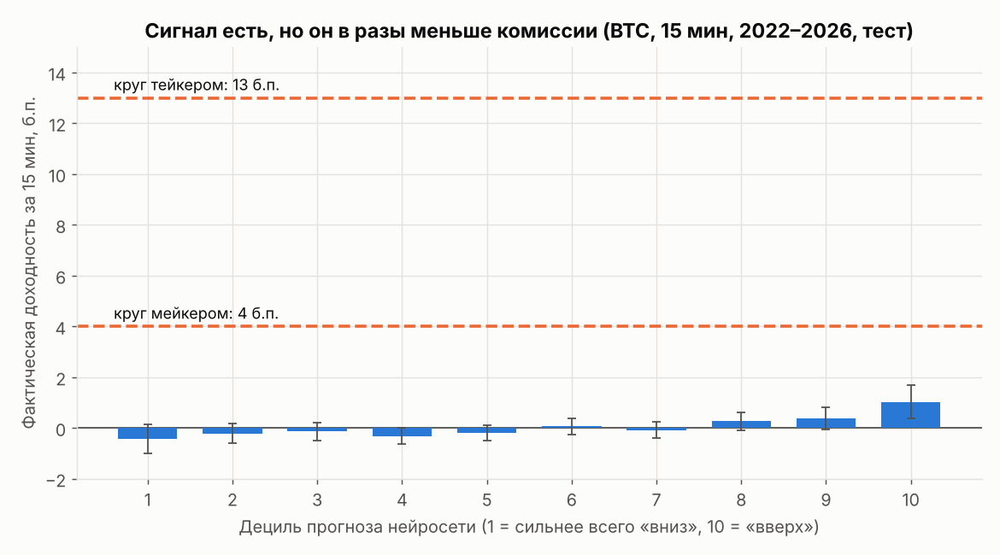
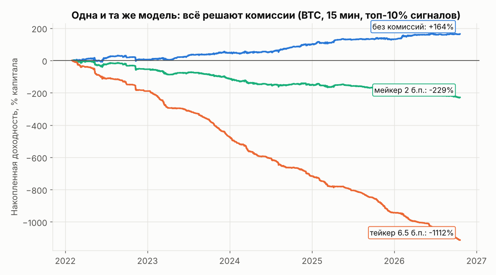

# Нейросеть видит сигнал, комиссии его съедают

Коротко: нет. По данным этой сессии и по литературе, стратегию на 5–60 минут для BTC, которая после комиссий была бы в плюсе «почти всегда», машинное обучение не даёт. Проверка шла на 3,6 млн минутных свечей Bitstamp BTC/USD за 2020–2026 годы. Нейросеть действительно нашла устойчивую закономерность: **ранговая корреляция прогноза с фактом (IC) 0,045–0,06, положительная в 85–100% кварталов**, тогда как контроль с перемешанной целью даёт ноль. Но в базисных пунктах это **около 1–2 б.п. на сделку при издержках 4 б.п. за круг мейкером и 13 б.п. тейкером**. Лучший вариант без комиссий приносит +34% в год (t = 3,1). С мейкерской комиссией тот же вариант теряет 48% в год, с тейкерской 231%. Классические индикаторы (EMA, Дончиан, моментум, RSI, Боллинджер: 52 набора параметров) после комиссий на 5 и 15 минутах тоже не прибыльны. Сама цель «плюс почти всегда» требует годового Шарпа 4,4 и выше. Такие кривые в природе дают скрытый хвостовой риск (сетка, мартингейл, продажа опционов), утечка данных в бэктесте или мошенничество. Реалистичный ориентир для честной стратегии с настоящим преимуществом: Шарп 1–2 и 60–70% прибыльных месяцев. Дальше имеет смысл двигать четыре рычага: снижать издержки, переходить на более волатильные инструменты, добавлять информацию, которой нет в цене BTC, и торговать реже. Из них в этой сессии проверены только частично первый и четвёртый.

## Плюс почти всегда означает Шарп 4,4+, а таких стратегий не бывает

Цель «в плюсе почти всегда» легко перевести в цифры. Пусть месячные доходности нормальны и независимы. Тогда доля прибыльных месяцев равна Φ(S/√12), где S — годовой коэффициент Шарпа. Так оценивают и исследователи, собиравшие материалы для этого отчёта.

| Годовой Шарп | Доля прибыльных месяцев | Вероятность убыточного года | Кто так живёт |
|---|---|---|---|
| 0,5 | 56% | 31% | индекс трендовых CTA (SG Trend, 0,47 за 26 лет) |
| 1,0 | 61% | 16% | хорошая системная стратегия |
| 2,0 | 72% | 2% | сильный market-neutral фонд в удачные годы |
| 3,0 | 81% | 0,1% | уже вызывает подозрение в бэктесте |
| **4,4** | **90%** | ≈0 | HFT и маркет-мейкеры с инфраструктурой у биржи |
| 5,7 | 95% | ≈0 | профиль Madoff |

Индекс трендовых стратегий SG Trend за декабрь 1999 — июнь 2026 дал **Шарп 0,47** ([arXiv 2607.19497](https://arxiv.org/pdf/2607.19497)). При таком Шарпе восьмимесячные периоды около нуля «не являются необычными» ([CFM](https://www.cfm.com/is-trend-really-having-a-bad-year/)). У крипто-фондов доходность в основном объясняется самим рынком. Индекс HFR Cryptocurrency за пять лет до февраля 2025 года показал **51,4% годовых при волатильности 59,5%** ([The Full FX](https://thefullfx.com/hfr-expands-crypto-fund-performance-data/)). Market-neutral фонды заработали медианные +26% в 2021 году ([AIMA](https://www.aima.org/article/press-release-more-than-a-third-of-traditional-hedge-funds-now-invest-in-digital-assets-nearly-double-a-year-ago-pwc-global-crypto-hedge-fund-report-2022.html)) и ушли в минус −3,55% в начале 2025 года ([Galaxy VisionTrack](https://visiontrack.galaxy.com/indices/)).

Гладкие «почти всегда прибыльные» кривые обычно продают хвостовой риск. У фонда, которым управляла фирма Madoff, было **7 убыточных месяцев из 174** (96% прибыльных). Маркополос назвал такую картину невозможной в финансах ([NBC News](https://www.nbcnews.com/news/amp/wbna28310980)). Эндрю Ло описал гипотетический фонд, продающий опционы пут вне денег с плечом. С 1992 по 1999 год у него была блестящая гладкая история, и всё это время он нёс риск катастрофы ([Time](https://business.time.com/?p=1928)). Сеточные боты устроены похоже. Если цена уходит ниже сетки, бот «остаётся с полной корзиной убыточных позиций», и стоп-лосс у него не обязателен ([TradingView](https://it.tradingview.com/scripts/bot)). С маржой такие потери заканчиваются ликвидацией, и «средства могут обнулиться» ([XREX](https://support.xrex.io/en/articles/9556690-what-are-the-risks-and-rewards-of-margin-grid)).

Фон для частного трейдера тоже неутешительный. **Меньше 3% тайваньских дейтрейдеров** предсказуемо зарабатывают после издержек ([Barber et al.](https://faculty.haas.berkeley.edu/odean/papers/day%20traders/day%20trading%20and%20learning%20110217.pdf)). Среди бразильских дейтрейдеров, торговавших не меньше 300 дней, **97% потеряли деньги** ([FGV](https://repositorio.fgv.br/items/e87d04fc-4b4c-4a56-ab5a-1c84c1afde1b)). Честная цель для бота поэтому скромнее: Шарп 1–2 после издержек, 60–70% прибыльных месяцев, просадки 10–30% и ожидание, что преимущество со временем ослабеет. Бэктест с Шарпом выше 3 или с долей прибыльных месяцев выше 90% надо считать ошибочным, пока не доказано обратное.

## Классика проигрывает комиссиям, а скорость ноутбука не важна

Первая серия экспериментов этой сессии проверила пять классических стратегий на минутных свечах Bitstamp с января 2020 по октябрь 2026 года ([REPORT.md](../research/REPORT.md)). Параметры подбирались по прошлому году и проверялись на следующем (walk-forward). Издержки моделировались на трёх уровнях: без комиссий, мейкер 2 б.п. на сторону, тейкер 5,5 б.п. плюс 1 б.п. проскальзывания.

Главная проблема видна ещё до моделей. **Медианный 5-минутный бар проходит 7,1 б.п., а круг сделки тейкером стоит около 13 б.п.** На 15 минутах медиана 12,3 б.п., то есть один круг тейкером примерно равен типичному движению. Стратегии на возврат к среднему без комиссий выглядят хорошо: Боллинджер на 5 минутах дал **+64,8% годовых при Шарпе 1,34**. Но средняя сделка у него всего **+1,9 б.п.**, и с мейкерской комиссией результат превращается в −15% годовых. Сам эффект тает: прибыль без комиссий упала с +233% в 2021 году до +11% в 2026-м, а автокорреляция 5-минутных доходностей ослабла с −0,02…−0,03 до −0,001. Это согласуется с выводом Sensoy о том, что внутридневной рынок BTC с 2016 года становится всё эффективнее ([ScienceDirect](https://www.sciencedirect.com/science/article/abs/pii/S1544612318302320)).

Единственные «плюсы» после комиссий дали EMA-кросс на 15 минутах с мейкером (+17,3%) и на 60 минутах с тейкером (+13,6%). Оба результата — замаскированная ставка на рост: **вся прибыль приходит от лонгов, шорты убыточны**. При этом простое удержание BTC за 2021–2026 годы дало +35% в год с меньшим риском.

Хорошая новость касается скорости. Если исполнять сделку на 1–5 минут позже закрытия бара, средняя сделка на 5–15 минутах теряет доли базисного пункта или пару б.п. Задержка домашнего интернета (0,05–0,2 с) на этих горизонтах ничего не решает. Слабый ноутбук здесь не главное ограничение. Главное ограничение — отношение преимущества к комиссии.

## Нейросеть нашла настоящий сигнал размером в один базисный пункт

Вторая серия проверяла машинное обучение: LightGBM и небольшую нейросеть MLP (64→32 нейрона, функция потерь Хьюбера) на 30 признаках из цены и объёма. Признаки описывали доходности в единицах волатильности, режимы волатильности, тени свечей, отклонения от EMA, RSI, положение в канале Дончиана, время суток и день недели. Схема walk-forward была такой: модель учится на двух годах, торгует следующие три месяца, затем переобучается. Между обучением и тестом оставлен зазор длиной в горизонт прогноза, исполнение идёт через минуту после закрытия бара. Тестовые кварталы покрывают 2022 — октябрь 2026 года. Для контроля ту же процедуру прогоняли с перемешанной целевой переменной ([ml_study.py](../research/ml_study.py), [ml_results.csv](../research/ml_results.csv)).

| Таймфрейм : горизонт | IC нейросети | Доля кварталов с IC > 0 | IC LightGBM | IC контроля (перемешано) |
|---|---|---|---|---|
| 60 : 60 мин | 0,060 | 95% | 0,002 | 0,012 |
| 15 : 60 мин | 0,052 | 100% | −0,006 | −0,003 |
| 15 : 15 мин | 0,058 | 100% | 0,021 | 0,005 |
| 5 : 15 мин | 0,045 | 100% | 0,002 | 0,011 |

У нейросети IC 0,045–0,06. Это верхняя часть диапазона, который показали лучшие участники соревнования G-Research на живых 15-минутных данных: в итоговом рейтинге 6-е место набрало **0,0203** ([Kaggle](https://www.kaggle.com/competitions/g-research-crypto-forecasting/leaderboard)). Метрика там была другая (корреляция Пирсона по 14 монетам на остаточных доходностях), так что сравнение ориентировочное. Сигнал устойчив во времени, контроль даёт ноль, значит, это не артефакт процедуры. При этом **ни одна модель не заработала после комиссий при торговле по знаку прогноза**. Немногие положительные строки оказались шумом. LightGBM на 5 минутах с тейкером дал +6,7% в год, но при **5,6 сделках в год**. Контроль с перемешанной целью в похожей конфигурации дал **+8,2%**.

Слабость LightGBM на фоне побед градиентного бустинга в G-Research, где все три призовых места заняли решения на LightGBM ([G-Research](https://www.gresearch.com/news/wrapping-up-the-g-research-crypto-forecasting-competition/)), скорее всего объясняется настройкой. Бустинг обучался с квадратичной потерей на доходностях с тяжёлыми хвостами и подстраивался под выбросы. Нейросеть получала стандартизированные и обрезанные признаки и робастную функцию потерь. Это гипотеза, она не проверялась. Её стоит проверить, запустив LightGBM с целевой функцией Хьюбера или с целью, нормированной на волатильность.

Третья серия переводила сигнал ансамбля из трёх нейросетей в торговлю ([ML_SIGNAL_REPORT.md](../research/ML_SIGNAL_REPORT.md)). Таблица децилей показывает масштаб проблемы. На 15 минутах верхний дециль прогноза в среднем дал **+1,03 б.п.**, нижний **−0,43 б.п.**, доля роста 55,4% против 44,3%. Монотонность есть, но весь разброс между крайними децилями (около 1,5 б.п.) в несколько раз меньше даже мейкерского круга.

Затем проверили редкую торговлю: вход только тогда, когда |прогноз| превышает квантиль 90/95/98/99% прогнозов за прошлые 90 дней, с удержанием позиции на весь горизонт. Лучший результат без комиссий дала конфигурация 15:15 с верхними 10% сигналов: **+34,1% в год, t = 3,1, 95% интервал [+13,5%; +55,2%], Шарп 1,5, 76% прибыльных месяцев**. Если бы торговля была бесплатной, это была бы хорошая стратегия. Но она совершает 2044 сделки в год со средней сделкой **+1,7 б.п.** С мейкерскими 4 б.п. за круг получается **−47,6% в год**, с тейкерскими 13 б.п. **−231,5%**.

На графике кумулятивная доходность без реинвестирования: +164% без комиссий, −229% с мейкером, −1112% с тейкером. Суммы ниже −100% означают, что реальный счёт обнулился бы гораздо раньше.

Лучшие строки после комиссий дал самый жёсткий фильтр (квантиль 0,99) с мейкерскими комиссиями: +3,3% в год на 15:60 и +2,9% на 60:60. У них **t ≈ 0,5, а доверительные интервалы захватывают ноль** ([−7,9%; +14,0%] и [−6,3%; +11,6%]). Всего в этой таблице 48 строк: 4 конфигурации × 4 порога × 3 уровня издержек. Бейли и соавторы показывают, что при всего 7 попытках ожидается хотя бы один двухлетний бэктест с Шарпом выше 1 даже при нулевом истинном Шарпе ([Notices of the AMS](https://carmamaths.org/jon/backtest.pdf)). Харви, Лю и Чжу предлагают требовать от нового фактора t > 3 ([NBER](https://www.nber.org/papers/w20592)). По этому порогу ни одна строка после комиссий не проходит. Строка без комиссий с t = 3,1 проходит еле-еле и только потому, что сигнал настоящий.

Литература говорит то же самое. Jaquart и соавторы получили на BTC (горизонты 1–60 мин) валовую доходность long-short **до ~31% в месяц**, но после издержек она **отрицательна** из-за коротких удержаний ([ResearchGate](https://www.researchgate.net/publication/350199855_Short-Term_Bitcoin_Market_Prediction_via_Machine_Learning)). У Kitron и Wengrowicz краткосрочный откат на 15 минутах значим примерно у 90% из 183 пар Binance и подтверждается на полугодовом отложенном периоде. Однако валовое преимущество у них около **1,3 б.п. против 5 б.п. за круг**, и они делают вывод, что эффект «не эксплуатируем» по публичным тарифам ([arXiv 2608.21888](https://arxiv.org/abs/2608.21888)).

## Преимущество равно IC × σ, и это задаёт четыре рычага

Все результаты выше сводятся к одной формуле. Ожидаемый доход сделки примерно равен **IC × σ_h × z**, где σ_h — волатильность за горизонт удержания, а z — сила сигнала, на котором мы входим. В верхних 10% сигналов z ≈ 1,75, в верхнем 1% z ≈ 2,7.

Для BTC на 15 минутах σ ≈ 25 б.п. При IC = 0,06 теория даёт около 2,6 б.п. на сделку в верхнем дециле, на практике получилось 1,7 б.п. Отсюда легко посчитать, какой IC нужен для безубыточности. В верхних 10% сигналов мейкеру нужен IC ≈ 0,09 даже в идеальной теории, тейкеру около 0,30. Таких значений на 15-минутном горизонте не показывал никто. В G-Research победители набрали 0,02–0,05. Отсюда видно, почему более умная модель на тех же данных задачу не решит. Нужно двигать другие множители формулы.

**Рычаг 1: издержки (частично проверен).** Тот же сигнал без комиссий даёт t = 3,1, а при 2 б.п. на сторону уже глубокий минус. Значит, всё решает тариф. Нужны нулевые или отрицательные мейкерские комиссии, VIP-уровень или площадки с нулевой комиссией, и исполнение только лимитными ордерами. Ограничение важное: в бэктесте мейкерский ордер считался исполненным всегда. В реальности лимитник исполняется чаще всего тогда, когда цена идёт против вас (неблагоприятный отбор), поэтому строки «мейкер» оптимистичны. Режим комиссий меняет и саму информативность потока ордеров. После того как Binance в марте 2023 года отменила нулевые комиссии, объяснительная сила дисбаланса ордеров для изменений цены BTC/USDT выросла **с 5% до 21,55% R²** ([Springer](https://link.springer.com/chapter/10.1007/978-3-032-18109-1_13)).

**Рычаг 2: волатильность инструмента (не проверен).** Комиссия берётся в процентах, а σ альткоинов в разы выше, чем у BTC. Если IC сохранится, доход на сделку вырастет пропорционально. Есть доводы за эту идею. BTC ведёт альткоины (причинность по Грейнджеру в одну сторону), а мелкие монеты реагируют с заметной задержкой ([Springer 2026](https://link.springer.com/article/10.1007/s10690-026-09589-z)). Краткосрочный откат широко распространён на парах Binance ([arXiv 2608.21888](https://arxiv.org/abs/2608.21888)). Есть и доводы против: у альткоинов шире спреды и тоньше стакан, а в многомонетных исследованиях есть ошибка выжившего. Без данных по альткоинам этот вопрос не решить.

**Рычаг 3: новая информация (не проверен).** Модели этой сессии видели только цену и объём одной монеты на одной бирже. Литература даёт несколько кандидатов, но ни один не доказан как прибыльный после издержек для частного трейдера. Ставка фандинга хорошо прогнозируется сама ([SSRN](https://papers.ssrn.com/sol3/papers.cfm?abstract_id=5576424)), а как предиктор цены слаба. По отраслевой оценке, изменения фандинга объясняют около **12,5% вариации 7-дневных движений цены** и полезнее в кросс-секции ([Presto Labs](https://www.prestolabs.io/research/can-funding-rate-predict-price-change)). Дисбаланс потока ордеров предсказывает цену на 1–10 секунд с R² **0,17–1,00%**, и примерно в половине дней результат нулевой ([SSRN](https://papers.ssrn.com/sol3/papers.cfm?abstract_id=7227998)). Для 5–60 минут это скорее признак для исполнения, чем для направления. Время суток и минута часа устойчиво предсказывают волатильность (пик около 16 UTC, всплески в начале часа), но не направление ([arXiv 2109.12142](https://arxiv.org/pdf/2109.12142)). Притоки стейблкоинов на биржи предсказывают рост BTC и ETH на горизонте в часы, но это показано только на обучающей выборке ([arXiv 2411.06327](https://arxiv.org/abs/2411.06327)).

**Рычаг 4: торговать реже и дольше (частично проверен).** Этот рычаг работает в литературе. Bysik и Ślepaczuk на часовых данных BTC показали, что наивные стратегии по знаку прогноза рушатся при 10 б.п. издержек. Фильтр «торговать, только если прогноз больше издержек» вернул некоторым конфигурациям XGBoost положительный результат после комиссий, но преимущество одной модели над другой статистически хрупкое ([arXiv 2606.00060](https://arxiv.org/abs/2606.00060)). В экспериментах этой сессии редкая торговля на 60 минутах подняла среднюю сделку до +4,9 б.п. после мейкерской комиссии. Но сделок осталось 58 в год, и t = 0,6 — это шум. Рычаг здесь упирается в статистику: чем реже сделки, тем дольше ждать доказательства.

## Бэктест обманывает утечкой, перебором и бесплатным исполнением

Чтобы найти «прибыльную» стратегию, достаточно трёх ошибок. Каждая хорошо задокументирована, и эксперименты этой сессии показывают их на конкретных цифрах.

Первая ошибка — подбор параметров задним числом. В последней колонке [REPORT.md](../research/REPORT.md) показан результат лучших параметров, выбранных на всей истории. Он систематически лучше честной проверки: пробой Дончиана на 60 минутах даёт +28,1% годовых задним числом против −1,4% в walk-forward, EMA на 15 минутах с тейкером +12,1% против −6,8%. Именно такие графики обычно показывают в рекламе ботов. На 888 алгоритмах Quantopian бэктестовый Шарп почти не предсказывал результат вне выборки (**R² < 0,025**), и чем больше пользователь гонял бэктестов, тем больше был разрыв ([Wiecki et al.](https://www.researchgate.net/publication/307553701_All_That_Glitters_Is_Not_Gold_Comparing_Backtest_and_Out-of-Sample_Performance_on_a_Large_Cohort_of_Trading_Algorithms)). Опубликованные аномалии на акциях теряют **26% доходности вне выборки и 58% после публикации** ([McLean & Pontiff](https://Www.Gwern.net/doc/economics/2016-mclean.pdf)). Защита: вести журнал всех попыток, считать дефлированный Шарп и вероятность переобучения (PBO) ([SSRN](https://papers.ssrn.com/abstract=2326253)), держать нетронутый финальный период и обязательно прогонять контроль с перемешанной целью. Здесь именно этот контроль разоблачил «+6,7% в год».

Вторая ошибка — утечка будущего. Метки с перекрывающимися окнами требуют очистки и зазора между обучением и тестом ([Wikipedia: Purged CV](https://en.wikipedia.org/wiki/Purged_cross-validation)). В одной статье 2026 года ошибка выравнивания нескольких таймфреймов **завысила ROC-AUC примерно на 0,20** ([MDPI](https://www.mdpi.com/2571-9394/8/3/40)). Репликация решения G-Research показала **0,2176 на кросс-валидации против ~0,02 вживую** ([GitHub](https://github.com/Wy66wy/g-research-crypto-forecasting)). Точность 70–80% на минутных горизонтах почти всегда означает утечку или горизонт в секунды. Честные исследования дают 51–56%, а на 5-минутных фьючерсах MNQ ни бустинг, ни LSTM не отличились от случая (p = 0,135 и 0,515) ([arXiv 2605.17724](https://arxiv.org/abs/2605.17724)). У нейросети этой сессии цена растёт после 55% сигналов верхнего дециля и только после 44–45% сигналов нижнего, то есть точность в крайних децилях около 55%. Это согласуется с честной частью литературы.

Третья ошибка — бесплатное или идеальное исполнение, и от неё не свободны и наши эксперименты. Исполнение по цене закрытия минутной свечи захватывает «дребезг» между бидом и аском: часть эффекта возврата к среднему на Bitstamp может быть именно им. Мейкерский ордер в бэктесте исполняется всегда. Фандинг не учтён. Данные охватывают одну монету и одну спотовую биржу. Добавим скрытую бету: прибыль трендовых правил целиком пришла от лонгов на растущем рынке. Поэтому даже положительные строки этой сессии надо считать верхней оценкой, а не прогнозом.

## План для бота на слабом ноутбуке: сначала данные, потом статистика, потом paper

В репозитории уже есть почти всё нужное: событийный маркет-мейкер (Авелланеда–Стойков) с риск-лимитами и kill switch, paper- и live-шлюзы через ccxt, запись маркет-даты и бэктестер с моделью очереди. Не хватает данных и строгих критериев отбора. Ниже шаги в порядке приоритета.

| № | Шаг | Что конкретно сделать | Критерий перехода дальше |
|---|---|---|---|
| 1 | Не запускать направленную ML-стратегию на BTC вживую | Результаты выше — её отрицательный тест при текущих тарифах | — |
| 2 | Узнать свои реальные издержки | Посмотреть свой уровень комиссий мейкера и тейкера на бирже, наличие ребейтов и пар с нулевой комиссией. Записать спред и долю исполнения лимитников через `main.py record` | Известна реальная стоимость круга в б.п. |
| 3 | Скачать данные альткоинов **на своей машине** (из песочницы этой сессии data.binance.vision недоступен) | `python research/download_binance.py SOLUSDT --start 2022-01 --end 2026-09 --market futures` для 10–20 монет, включая делистингованные. Скрипт сам приводит метки времени к секундам, а `ml_study.py` заполняет пропущенные минуты. Отдельно скачать архивы фандинга и открытого интереса из раздела futures/um | Файлы `data/binance_*_1m.csv` готовы |
| 4 | Перезапустить `research/ml_study.py` и `research/ml_signal.py` по каждой монете | Те же walk-forward, контроль и издержки. Дополнительно LightGBM с целевой функцией Хьюбера. Сравнить IC × σ с BTC | IC стабилен по кварталам, и IC × σ заметно выше 1–2 б.п. |
| 5 | Добавить новую информацию | Признаки: доходности BTC/ETH за последние 1–60 минут для альткоина, фандинг и его изменение, ΔOI, базис спот–перп, ранг монеты по доходности среди остальных. Для живой торговли расширить recorder запросами фандинга и OI через ccxt | Прирост IC вне выборки при сохранённом контроле ≈ 0 |
| 6 | Статистический фильтр | Вести журнал всех конфигураций. Требовать **t > 3 после издержек** с консервативным учётом мейкерских исполнений, плюс на большинстве монет и кварталов, и подтверждения на финальном отложенном периоде (например, 2026 год, не смотреть до конца) | Проходят единицы конфигураций или ни одной, и это нормальный исход |
| 7 | Сигнал как поправка к маркет-мейкеру | Слабый прогноз на 1–2 б.п. не окупает комиссию сам по себе, но может сдвигать котировки и инвентарь существующего маркет-мейкера в сторону прогноза и снижать неблагоприятный отбор. Проверить в `backtest` на записанных данных | Средний результат на исполненный ордер растёт по сравнению с версией без сигнала |
| 8 | Paper, затем минимальный депозит | 4–8 недель paper/testnet, затем минимальный размер без плеча, kill switch включён | Доля исполнений, проскальзывание и средняя сделка совпадают с бэктестом |

Последний шаг требует трезвых ожиданий. Paper-торговля проверяет исполнение, а не наличие преимущества. При разбросе сделки около 25 б.п. и преимуществе 2 б.п. для t = 3 нужно примерно (3 × 25 / 2)² ≈ **1400 сделок**, а это месяцы торговли. Шесть недель покажут, совпадают ли доля исполнения лимитников и проскальзывание с бэктестом, но не докажут прибыльность. Ноутбук для всего этого подходит. Обучение на двух годах 5-минутных баров — это около 210 тысяч строк, и небольшая нейросеть на процессоре справляется с ними за минуты. Задержка в 1–5 минут результат почти не меняет. Для живой торговли 24/7 нужен VPS, а не ноутбук, как и написано в README бота.

## Заключение

Интуиция «больше данных и модель сложнее — значит, прибыль» здесь ломается в неожиданном месте. Сеть справилась со своей работой: она нашла сигнал, сопоставимый с лучшими публичными результатами на живых данных, и сигнал устойчив во времени. Но предсказуемость BTC на 5–60 минутах ограничена не качеством модели, а размером движения по сравнению с комиссией. Поэтому следующий шаг — не новая архитектура, а смена условий задачи: дешевле исполнение, волатильнее инструмент, данные, которых нет в цене, и меньше сделок. Из этих направлений в сессии проверены только частично издержки и частота, а альткоины, фандинг и OI ещё ждут данных.

Самый ценный практический вывод касается того, как читать будущие результаты. Если после таких изменений бэктест вдруг покажет «плюс почти всегда», это повод искать ошибку, а не запускать бота. Правдоподобный успех выглядит скромнее: t > 3 после издержек на нескольких монетах, Шарп 1–2, треть убыточных месяцев. Возможно, лучшее применение найденного сигнала — встроить его в уже написанный маркет-мейкер, где 1–2 б.п. преимущества помогают решать, в какую сторону сдвинуть котировки, вместо отдельной стратегии, которая платит комиссию за каждый вход.
