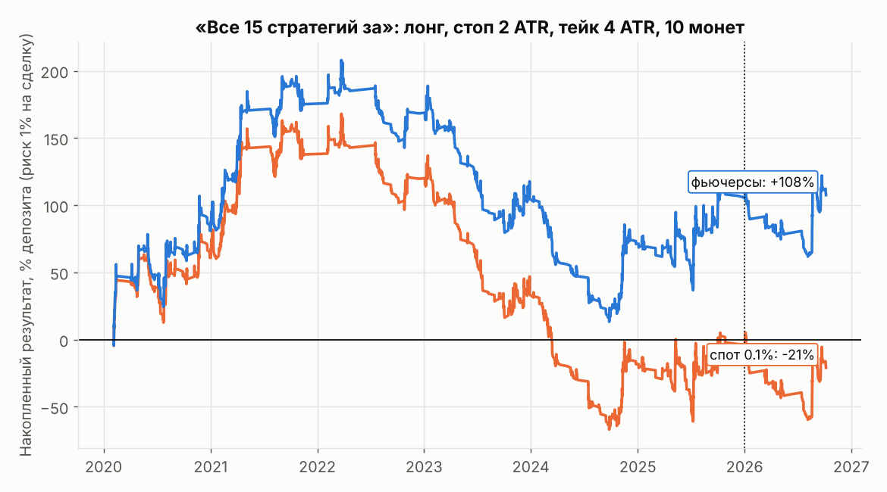
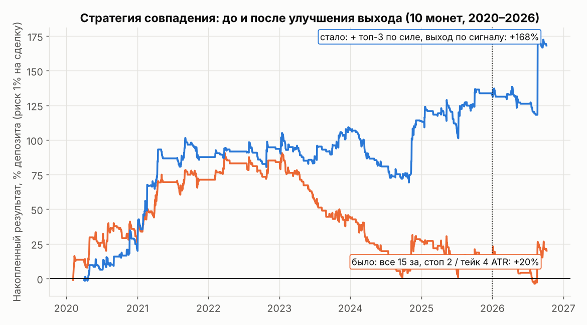

# «Входить, только когда согласны все 15 стратегий»

Скрипты: [`confluence_study.py`](confluence_study.py), [`confluence_report.py`](confluence_report.py).
Стратегии: [`signalbot/indicators.py`](../signalbot/indicators.py) (тот же код использует бот сигналов).
Данные: часовые свечи Binance по 10 монетам, 2020 — октябрь 2026.

## 15 стратегий

EMA 20/50 · цена vs EMA 200 · MACD · RSI · канал Дончиана 48 ч · Боллинджер %B · ADX + DI · Supertrend ·
облако Ишимоку · объём + движение 24 ч · сила монеты относительно BTC за 7 дней · режим рынка (BTC vs EMA
за 30 дней) · стохастик · OBV · VWAP 24 ч.

Все они трендовые: стратегии «на отскок» по определению противоречат трендовым, и с ними «согласие всех»
не наступало бы почти никогда. Большинство индикаторов считается из одной и той же цены, поэтому их согласие
часто означает одну и ту же информацию, посчитанную много раз.

## Что показала проверка

Вход в первый час, когда «за» не меньше N стратегий. Выход по стопу или тейку в ATR или через 24 ч.
Ручной вход стоит 10 б.п. проскальзывания, при касании стопа и тейка в одном часе засчитывается стоп.

* **Порог 8–14 голосов**: сигналов тысячи в год, все варианты убыточны и не лучше случайных входов.
* **15 из 15, лонг**: около 530 сигналов в год на 10 монет (1–2 в день). Это **лучше случайного входа
  на растущем рынке на 15–29 б.п.** при всех четырёх схемах стоп/тейк (t до 2.3), и это подтвердилось
  на 2026 году. Шорты при 15/15 хуже случайных.
* **Но в деньгах при риске 1% на сделку** (стоп 2 ATR, тейк 4 ATR, фьючерсы Bybit):

| Год | 2020 | 2021 | 2022 | 2023 | 2024 | 2025 | 2026 |
|---|---|---|---|---|---|---|---|
| % депозита | +81 | +94 | −7 | **−63** | **−34** | +35 | +2 |

Средний результат около **+0.03R на сделку** (t = 1.4), прибыльных месяцев 41%, просадка почти 200%
депозита (без реинвестирования). На споте с комиссией 0.1% результат отрицательный. Вся прибыль пришлась
на бычий 2020–2021, а с 2022 по 2024 стратегия теряла.

* **15/15 только в монетах из топ-3 по моментуму относительно BTC**: на 2020–2025 лучше (+0.063R, t = 2.2,
  убыточен только 2023 год), но на экзаменационном 2026 году **−0.073R (−16% депозита)**.

## Вывод

Совпадение всех 15 немного улучшает качество входа по сравнению со случайным, но **после комиссий
устойчивого преимущества не даёт**: результат сильно зависит от того, был ли год бычьим. Поэтому бот
сигналов сделан как инструмент **проверки на будущем**: он присылает сигналы со стопом и тейком и сам
ведёт честную статистику по каждому. Входить реальными деньгами имеет смысл, только если за 2–3 месяца
его статистика (`/stats`) покажет устойчивый плюс.

## Улучшение (21 октября): выход важнее входа

Скрипты: [`confluence_v2.py`](confluence_v2.py) (20 вариантов, список зафиксирован до запуска),
[`confluence_final.py`](confluence_final.py) (итоговая версия).

Проверено 4 способа выхода × 4 фильтра входа + ML-взвешивание стратегий. Главное:

* **Выход по сигналу** («за» стало меньше 10 из 15) лучше фиксированного тейка почти при любом фильтре.
  Исходный выход «стоп 2 / тейк 4 ATR» оказался одним из худших (−40R за 2022–2026): тейк обрезает крупные
  трендовые движения, на которых стратегия и зарабатывает.
* **Устойчивость:** выход по сигналу + фильтр «топ-3 по силе отн. BTC» прибылен во всех 15 сочетаниях порога
  (8–12 голосов) и максимального удержания (48–96 ч), почти везде 7 лет из 7, и **во всех вариантах в плюсе
  на 2026 году**. Это широкое плато, а не удачная точка. Выбрана середина: порог 10, удержание 72 ч.
* ML-взвешивание стратегий не помогло: нестабильно по годам.
* Walk-forward по всему меню из 20 вариантов дал около нуля (в 2026 году правило выбора переключилось на
  ML-вариант, а тот провалился). Поэтому итоговый вариант выбран не «лучшим по таблице», а по устойчивости
  семейства «выход по сигналу».

### Итоговые правила

Вход: все 15 «за» и монета в топ-3 по силе относительно BTC за 7 дней. Стоп 2 ATR сразу. Тейка нет.
Выход: когда «за» стало меньше 10 из 15 (бот пишет «выходите») или через 72 ч.

| | Значение |
|---|---|
| Сделок | ~150 в год на 10 монет |
| Прибыльных | 30% |
| Средняя прибыльная / убыточная | +2.43R / −0.81R |
| Средний результат | +0.17R на сделку (t = 2.3) |
| При риске 1% на сделку | в среднем +24% депозита в год, макс. просадка 40% |
| По годам | 2020: +21, 2021: +66, 2022: +6, 2023: +15, 2024: +5, 2025: +19, **2026: +36** |
| Удержание | медиана 13 ч, 75% сделок до 22 ч |
| Одновременно открыто | до 6 позиций |

### Что важно знать

* **Прибыль дают редкие крупные сделки.** Без 5 лучших сделок каждый год убыточен. Результат 2026 года
  почти целиком держится на двух сделках августа (SOL +23R, XRP +11R). Поэтому **нельзя пропускать сигналы
  или выбирать их «на глаз»**.
* Прибыльных месяцев 44%: долгие серии мелких убытков нормальны.
* t = 2.3 — ниже строгого порога 3. Параметры выбраны после просмотра данных 2020–2026 (с поправкой
  на устойчивость, но всё же). Только 10 монет, доживших до сегодня. Перед реальными деньгами нужна
  проверка на всём рынке (`download_binance.py --all-usdt`) и накопление статистики бота вживую.
* Бот сигналов воспроизводит исследование точно: прогон июль — сентябрь 2026 через живой код бота дал
  те же 28 сделок с теми же выходами и тем же результатом (+39.59R).

### Стоп: фиксированные 5% лучше 2 ATR ([`stop_comparison.py`](stop_comparison.py))

| Стоп | Покупка при риске $1 | Закрыто стопом | % депозита в год (риск 1%) | Макс. просадка | Лет в плюсе |
|---|---|---|---|---|---|
| 2 ATR (~3%) | ~$33 | 32% | +24 | 40% | 7/7 |
| 3% | ~$33 | 39% | +28 | 41% | 7/7 |
| **5% (по умолчанию в боте)** | ~$20 | 15% | +22 | **25%** | 7/7 |
| 10% | ~$10 | 2% | +14 | 13% | 7/7 |

Узкий стоп часто выбивает шум до того, как сработает выход по сигналу. Стоп 5% почти не уменьшает доход,
но сокращает просадку с 40% до 25%. Это ещё одна проверка на тех же данных; все варианты прибыльны 7 лет из 7.
