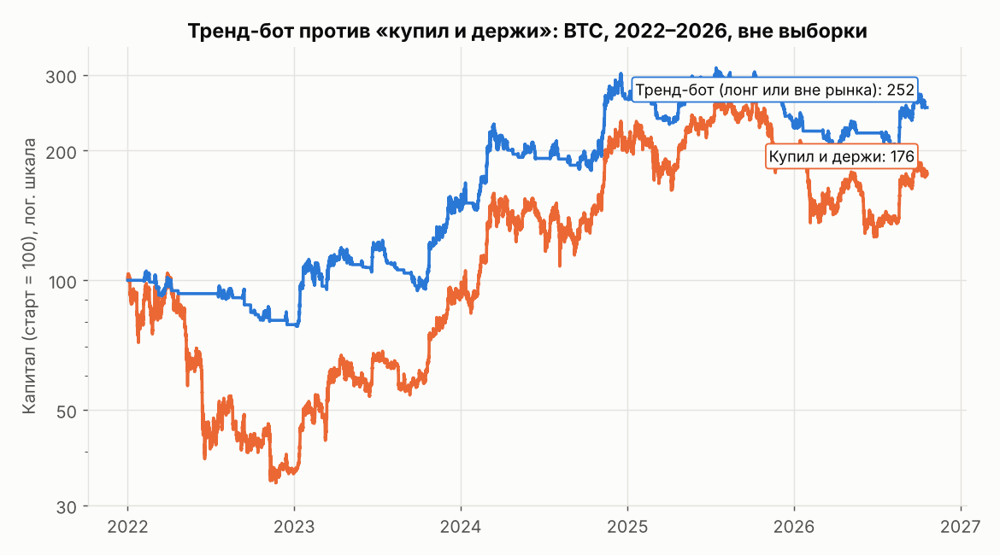

# Торговый бот (удержание от часа до недель): что работает на BTC

Данные: Bitstamp BTC/USD, минутные свечи 2020 — октябрь 2026. Все результаты вне выборки:
параметры выбираются по прошлому, проверка идёт на будущем.

## 1. Сделки на 1–4 часа с целью, стопом и ML-фильтром: преимущества нет

Скрипт: [`swing_study.py`](swing_study.py). Метод тройного барьера (López de Prado):
вход по сигналу, выход по цели, стопу или лимиту времени. Проверка поминутная, при касании
цели и стопа в одну минуту засчитывается стоп. Комиссии: вход тейкером 6.5 б.п., цель лимитным
ордером 2 б.п., стоп 8.5 б.п. с проскальзыванием. ML-фильтр (LightGBM) работает walk-forward,
есть контроль с перемешанной меткой.

* Проверено 3 сигнала × 2 удержания (1 ч, 4 ч) × 4 схемы барьеров × 3 варианта = 72 конфигурации.
* **Все сигналы без фильтра убыточны: от −11 до −20 б.п. на сделку** (t от −4 до −15).
  До комиссий средняя сделка около нуля, а круг стоит 9–15 б.п.
* ML-фильтр лишь сокращает убыток, почти перестав торговать.
* Лучшая конфигурация 2022–2025 годов («сильное отклонение, 1 ч, цель 1σ / стоп 2σ, ML»):
  +23.6 б.п., t = 3.2, но всего на 10 сделках. **На экзаменационном 2026 году та же конфигурация
  дала −16.9 б.п. на сделку (30 сделок, t = −1.7).** Это наглядная подгонка под историю.

## 2. Следование тренду с объёмом по волатильности: работает лучше, чем держать

Скрипт: [`trend_study.py`](trend_study.py). Бот решает раз в час: в позиции, пока цена в тренде
(пересечение EMA на часовых барах), иначе вне рынка. Размер позиции = 40% / текущая годовая
волатильность, без плеча. Комиссия тейкера на каждое изменение. Параметры каждый год выбираются
по двум предыдущим.

| Стратегия (2022 — окт. 2026, вне выборки) | Доходность/год | Шарп | Макс. просадка | Прибыльных месяцев | В рынке | 2022 | 2023 | 2024 | 2025 | 2026 |
|---|---|---|---|---|---|---|---|---|---|---|
| Купил и держи | +12.5% | 0.49 | 67% | 55% | 100% | −64% | +156% | +121% | −6% | −7% |
| Купил и держи, объём по волатильности | +16.9% | 0.59 | 55% | 55% | 100% | −51% | +128% | +109% | −3% | −6% |
| Тренд, лонг или вне рынка | +9.5% | 0.44 | 51% | 38% | 50% | −46% | +95% | +70% | −19% | +7% |
| **Тренд, лонг или вне рынка, объём по волатильности** | **+21.2%** | **0.81** | **36%** | 41% | 50% | −21% | +85% | +81% | −14% | +12% |
| Тренд, лонг/шорт | −3.9% | 0.17 | 66% | 52% | 100% | −42% | +77% | +17% | −39% | +13% |
| Тренд, лонг/шорт, объём по волатильности | +15.8% | 0.56 | 44% | 55% | 100% | +15% | +37% | +40% | −30% | +30% |

Лучший вариант («лонг или вне рынка» с объёмом по волатильности) по сравнению с «купил и держи»:

* **доходность выше (+21% против +12.5% в год), а просадка почти вдвое меньше (36% против 67%)**;
* в 2022 году бот потерял 21% против 64% у рынка: в основном он был вне рынка;
* прибыльна меньшая часть месяцев (41%). Это нормальный профиль тренд-стратегии: много мелких
  убытков и редкие крупные прибыли. Бот **не будет в плюсе почти всегда**;
* позиции живут от нескольких дней до недель: выбранные EMA медленные (12/336 … 96/720 часов);
* решения раз в час, на ноутбуке это несколько миллисекунд вычислений.

## Честные ограничения

* Шарп 0.81 за 4.8 года даёт t ≈ 1.8. Статистически это **не доказано** (порог t > 3),
  но механизм (time-series momentum) хорошо задокументирован в литературе для многих рынков,
  включая крипту.
* Одна монета, одна биржа, без фандинга. Перебрано 6 вариантов, лучший выбран после просмотра:
  это поправка на множественное сравнение.
* Большая часть выигрыша приходит от **управления размером позиции и ухода из рынка в медвежьи
  фазы**, а не от угадывания часовых движений.
