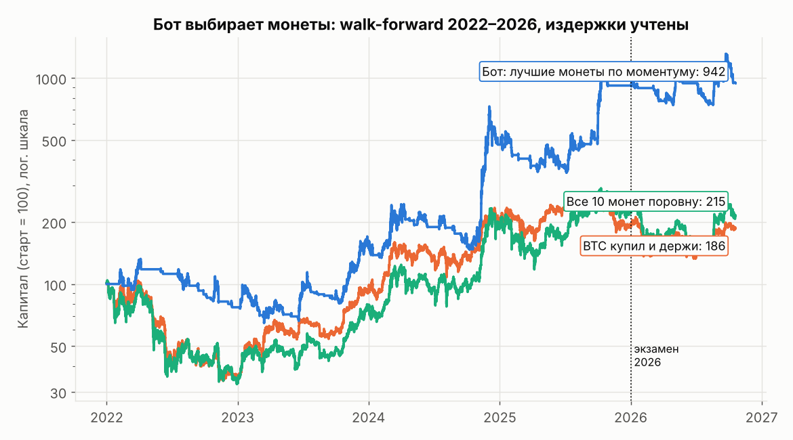

# Бот, который выбирает монеты из рынка (удержание от часов до суток)

Скрипт: [`xs_study.py`](xs_study.py). Данные: часовые свечи Binance по 10 монетам (BTC, ETH, SOL, BNB, XRP,
TRX, DOGE, ZEC, ADA, BCH), 2020 — 19 октября 2026, из
[Speirsy11/crypto-dataset](https://github.com/Speirsy11/crypto-dataset).

Каждые R часов (4, 8 или 24) бот ранжирует монеты по сигналу и держит k лучших (2 или 3) до следующего
пересмотра. Издержки: 8.5 б.п. на единицу оборота. Сигнал считается по закрытию часа, позиция открывается
со следующего часа. Конфигурация выбирается walk-forward по двум прошлым годам, 2026 год — экзамен.
Всего проверено 306 конфигураций.

## Какие сигналы работают: устойчиво только моментум

Медианный Шарп по всем вариантам семейства, 2022–2025 (у «купил и держи» BTC и у «всех монет поровну» 0.6):

| Семейство сигналов | Только лонг | Лонг при тренде BTC | Лонг/шорт |
|---|---|---|---|
| Моментум (кто рос, тот растёт), 24–336 ч | 0.76 | **1.16** (мин. 0.15) | 0.25 |
| Моментум относительно BTC | 0.87 | **1.25** (мин. 0.19) | 0.24 |
| Моментум с поправкой на волатильность | 0.79 | **1.04** (мин. 0.24) | 0.47 |
| Разворот (кто упал, тот отскочит) | −0.78 | −0.25 | −3.40 |
| Всплеск объёма | −0.62 | 0.37 | −3.06 |
| ML-ранжирование (LightGBM) | −0.35 | 0.48 | −2.72 |

* **Моментум в режиме «лонг при тренде BTC» положителен во всех 72 вариантах**: при любом окне, любой
  частоте пересмотра и любом числе монет. Это не случайная удачная настройка, а устойчивый эффект. Он
  согласуется с литературой: моментум — признанный фактор крипторынка (Liu, Tsyvinski, Wu, JF 2022).
* Разворот и всплески объёма проигрывают. ML-модель не обогнала простой моментум.
* Шорты слабых монет вредят: их «отскоки» дороги.
* Пересмотр раз в 8–24 часа лучше, чем раз в 4 часа: меньше комиссий.

## Walk-forward результат (конфигурация выбирается каждый год по прошлому)

| | Доходность/год 2022–2025 | Шарп | Макс. просадка | Прибыльных месяцев | **2026 (экзамен)** |
|---|---|---|---|---|---|
| BTC купил и держи | +17.3% | 0.6 | 67% | 56% | −2.1% |
| Все 10 монет поровну | +22.0% | 0.6 | 69% | 58% | −3.9% |
| Бот: только лонг | +35.2% | 0.77 | 91% | 48% | −7.9% |
| Бот: лонг/шорт | +21.0% | 0.77 | 30% | 46% | +2.9% |
| **Бот: лонг лучших монет при тренде BTC** | **+74.0%** | **1.24** | 52% | 46% | **+3.3%** |

Характер сделок (пример: моментум относительно BTC за 168 ч, пересмотр раз в 8 ч, 2 монеты):
монета держится в портфеле **медиана 16 ч, среднее 41 ч, половина позиций от 8 до 40 ч**.
Бот в рынке 53% времени. Это ровно тот диапазон «от нескольких часов до суток», который нужен.

## Честные ограничения

* **Ошибка выжившего.** Все 10 монет дожили до 2026 года и остались крупными. Монеты, которые выросли и
  потом умерли, в выборку не попали, и для лонг-стратегий это завышает результат. Перед реальными деньгами
  нужна проверка на 50+ монетах, включая исключённые с биржи (`download_binance.py ... --panel`).
* **2026 год гораздо скромнее 2022–2025:** +3.3% при падении рынка на 2–4%. Эффект может ослабевать.
* **Просадка 52%** и меньше половины прибыльных месяцев. Это не «плюс почти всегда», а стратегия с
  редкими крупными прибылями: основной рост пришёлся на несколько трендовых всплесков (конец 2024, 2025).
* Шарп 1.24 за 4 года даёт t ≈ 2.5: близко к порогу значимости, но не выше 3. Устойчивость по всем 72
  вариантам семейства — более сильный аргумент, чем значение у лучшей конфигурации.
* Спотовые данные без фандинга. Исполнение по цене закрытия часа.
